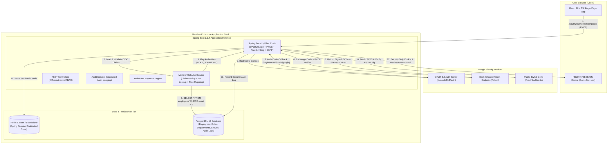
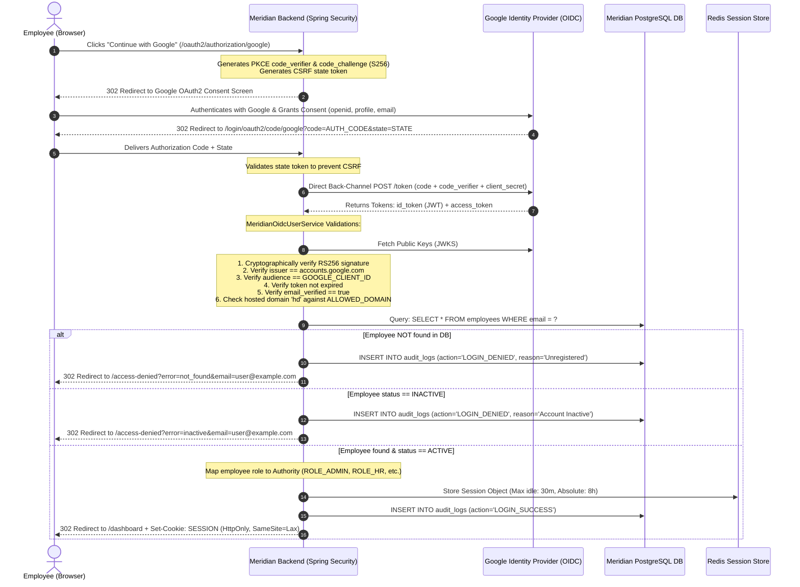

# Meridian Enterprise Identity & HRMS Portal

[](https://spring.io/projects/spring-boot)
[](https://www.oracle.com/java/)
[](https://react.dev/)
[](https://www.typescriptlang.org/)
[](https://openid.net/connect/)
[](https://redis.io/)
[](https://www.postgresql.org/)

**Meridian** is a production-grade enterprise employee portal (HRMS) built by a principal identity systems engineer to demonstrate **"Continue with Google"** authentication (OAuth 2.0 + OpenID Connect) coupled with **internal role-based authorization (RBAC)**.

---

## Core Security Tenet: Authentication ≠ Authorization

> [!IMPORTANT]
> **Authentication proves who you are; Authorization decides what you can do.**  
> Meridian strictly enforces the separation of identity from privilege:
> 1. **Google OIDC** cryptographically proves the user's identity via OpenID Connect (ID Token signature validated against Google's public JWKS).
> 2. **Meridian Database** decides access. Having a valid Google account **never** implies permission to enter the portal.
> 3. An internal database lookup on the `employees` table verifies that the email is pre-authorized and in an `ACTIVE` status before issuing a secure enterprise session. Unregistered or inactive accounts are immediately rejected and redirected to `/access-denied`.
> 4. **No Google API keys are ever used for login.** Meridian uses standard OAuth 2.0 Authorization Code Flow with **PKCE (Proof Key for Code Exchange)**.

---

## Architecture Overview

Meridian employs a secure, scalable architecture where the React SPA is compiled and served from the same origin as the Spring Boot API, eliminating CORS vulnerabilities in production. All user sessions are statefully stored in distributed Redis nodes, allowing backend application instances to remain completely stateless behind a load balancer.



---

## Detailed Sequence: How Google Login Works

The following sequence diagram illustrates the 10 distinct phases executed during an authentication and authorization exchange:



---

## Exact Google Cloud Console Setup

To configure Google OAuth 2.0 & OpenID Connect credentials for Meridian:

### Step 1: Create or Select a GCP Project
1. Navigate to the [Google Cloud Console](https://console.cloud.google.com/).
2. In the top navigation bar, click the Project dropdown and select **New Project**.
3. Set the Project name to `meridian-portal` and click **Create**.

### Step 2: Configure the OAuth Consent Screen
1. In the left sidebar, navigate to **APIs & Services** > **OAuth consent screen**.
2. Select User Type:
   - **Internal** (Recommended for Google Workspace organizations): Only users within your domain can log in.
   - **External** (For testing with general `@gmail.com` accounts): In Testing status, add test user emails.
3. Click **Create**.
4. Fill in App Information:
   - **App name**: `Meridian Enterprise Portal`
   - **User support email**: Your email address
   - **Developer contact information**: Your email address
5. Click **Save and Continue**.
6. On the **Scopes** screen, click **Add or Remove Scopes** and select:
   - `.../auth/userinfo.email`
   - `.../auth/userinfo.profile`
   - `openid`
7. Click **Update** and then **Save and Continue**.
8. (If External) On the **Test Users** screen, add the Google email addresses you plan to test with.
9. Click **Save and Continue**.

### Step 3: Create OAuth 2.0 Credentials (Web Application)
1. In the left sidebar, navigate to **APIs & Services** > **Credentials**.
2. Click **+ Create Credentials** at the top and select **OAuth client ID**.
3. Set **Application type** to `Web application`.
4. Set **Name** to `Meridian Web Client`.
5. Under **Authorized JavaScript origins**, add:
   ```
   http://localhost:8080
   http://localhost:5173
   ```
6. Under **Authorized redirect URIs**, add the exact Spring Security OAuth2 callback URI:
   ```
   http://localhost:8080/login/oauth2/code/google
   ```
7. Click **Create**.
8. A modal will display your **Client ID** and **Client Secret**. Copy these into your `.env` file.

---

## Role-Based Authorization Matrix

Meridian enforces method-level security with Spring Security `@PreAuthorize`:

| Capability | ADMIN | HR | MANAGER | EMPLOYEE |
| :--- | :---: | :---: | :---: | :---: |
| **Authenticate via Google OIDC** | Yes | Yes | Yes | Yes |
| **View Dashboard & Directory** | Yes | Yes | Yes | Yes |
| **View Personal Profile** | Yes | Yes | Yes | Yes |
| **Submit Leave Request** | Yes | Yes | Yes | Yes |
| **View Own Team Leave Requests** | Yes | Yes | **Yes** | No |
| **Approve/Reject Team Leave** | Yes | Yes | **Yes** | No |
| **Authorize New Employee (Add Email)** | **Yes** | **Yes** | No | No |
| **Edit Employee Role/Dept/Manager** | **Yes** | **Yes** | No | No |
| **Deactivate Employee (Block Login)** | **Yes** | **Yes** | No | No |
| **View All Company Leave Requests** | **Yes** | **Yes** | No | No |
| **View Security Audit Logs** | **Yes** | No | No | No |
| **View Auth Flow Inspector Trace** | **Yes** | Demo | Demo | Demo |

---

## Environment Variables Reference

Copy `.env.example` to `.env`:

```bash
cp .env.example .env
```

| Variable | Required | Default | Description |
| :--- | :---: | :---: | :--- |
| `GOOGLE_CLIENT_ID` | **Yes** | *None* | Google Cloud OAuth 2.0 Client ID |
| `GOOGLE_CLIENT_SECRET` | **Yes** | *None* | Google Cloud OAuth 2.0 Client Secret |
| `BOOTSTRAP_ADMIN_EMAIL` | **Yes** | `admin@meridian.internal` | Email auto-provisioned/promoted as active `ADMIN` on startup |
| `ALLOWED_DOMAIN` | No | *Empty* | Hosted domain restriction (matches Google's `hd` claim, e.g. `company.com`) |
| `DEMO_MODE` | No | `true` | Enables interactive simulation trace in Auth Flow Inspector |
| `DB_HOST` | No | `postgres` / `localhost` | PostgreSQL host |
| `DB_PORT` | No | `5432` | PostgreSQL port |
| `DB_NAME` | No | `meridian` | PostgreSQL database name |
| `DB_USER` | No | `meridian_user` | PostgreSQL database username |
| `DB_PASSWORD` | No | `meridian_secure_pass_2026`| PostgreSQL database password |
| `REDIS_HOST` | No | `redis` / `localhost` | Redis server host |
| `REDIS_PORT` | No | `6379` | Redis server port |
| `REDIS_PASSWORD` | No | `meridian_redis_pass_2026`| Redis auth password |
| `SESSION_STORE_TYPE` | No | `redis` | Session storage type (`redis` or `none`) |

---

## Running with Docker Compose (One Command)

To build and run the full production stack (PostgreSQL 16 + Redis 7 + Meridian App):

```bash
docker compose up --build
```

Access the application at:
- **Web Portal**: [http://localhost:8080](http://localhost:8080)
- **Actuator Health**: [http://localhost:8080/actuator/health](http://localhost:8080/actuator/health)
- **OpenAPI Swagger UI**: [http://localhost:8080/swagger-ui.html](http://localhost:8080/swagger-ui.html)

---

## Local Development & Testing

### Prerequisites
- Java 17 or higher
- Apache Maven 3.9+
- Node.js 18+ and npm

### 1. Run Backend Tests
Run the complete unit and integration security test suite (covering 401s, 403s, OIDC validations, CSRF, and role checks):
```bash
mvn -f backend/pom.xml test
```

### 2. Run Frontend Tests
Run component unit tests with Vitest:
```bash
cd frontend
npm test
```

### 3. Build & Run Locally
```bash
# 1. Build frontend bundle
cd frontend
npm run build
cd ..

# 2. Package and run executable jar
mvn -f backend/pom.xml package -DskipTests
java -jar backend/target/meridian-backend-1.0.0.jar
```

---

## Threat Model & Security Mitigations

| Threat | Attack Vector | Meridian Security Mitigation |
| :--- | :--- | :--- |
| **Account Takeover via Unverified Email** | Attacker creates Google account with victim's unverified corporate email. | `MeridianOidcUserService` enforces `email_verified == true`. Unverified tokens are rejected immediately with `UnverifiedEmailException`. |
| **Unauthorized Access (Valid Google Account)** | Attacker authenticates with personal `@gmail.com` account. | Google authentication **only** proves identity. Meridian queries the internal `employees` table; unknown or inactive emails trigger `LOGIN_DENIED` and redirect to `/access-denied`. |
| **Token Theft / Session Hijacking** | Malicious script steals tokens from `localStorage` or `sessionStorage`. | **Zero tokens stored in browser storage.** Meridian uses server-side sessions stored in Redis with `HttpOnly; SameSite=Lax; Secure` cookies inaccessible to JavaScript. |
| **Cross-Site Request Forgery (CSRF)** | Third-party website triggers state-changing actions (e.g. approve leave). | Cookie-based CSRF protection (`CookieCsrfTokenRepository` with `X-XSRF-TOKEN` validation) on all state-changing HTTP methods (`POST`, `PUT`, `DELETE`). |
| **Session Fixation** | Attacker fixes session ID prior to authentication. | Spring Security `sessionFixation().migrateSession()` generates a fresh session identifier upon successful OAuth2 authentication. |
| **Authorization Code Interception** | Malicious app on device intercepts OAuth2 redirect. | **PKCE (Proof Key for Code Exchange)** with SHA-256 code challenge ensures only the initiator with `code_verifier` can exchange the authorization code. |
| **Brute Force & DoS** | High-frequency API calls or authorization flood. | `Bucket4j` rate limiting filter restricts API calls (120 req/min) and OAuth2 endpoints (20 req/min) returning HTTP 429 Too Many Requests. |
| **Clickjacking & XSS** | Embedded iframe / malicious script injection. | OWASP security headers: strict Content-Security-Policy, `frame-ancestors 'none'`, `X-Content-Type-Options: nosniff`, and `Permissions-Policy`. |
| **Privilege Escalation** | Employee directly calls Admin/HR endpoints. | Method-level security (`@PreAuthorize("hasRole('ADMIN')")`) validated on server side; returns HTTP 403 Forbidden without leaking stack traces. |

---

## Performance & Horizontal Scalability

Meridian is designed to scale horizontally across hundreds of stateless application instances:

1. **Stateless Compute**: Application instances hold zero in-memory session state. All HTTP sessions are persisted to distributed Redis nodes via Spring Session. Instances can be scaled dynamically behind an AWS ALB or Nginx reverse proxy.
2. **Database Optimization**:
   - Indexes on frequently filtered columns: `email`, `status`, `department_id`, `role`, `manager_id`, and `created_at`.
   - Prevented N+1 queries using JPQL `JOIN FETCH` projections for departments and managers.
   - Tuned HikariCP connection pool with optimal connection reuse and lifetime settings.
3. **HTTP Caching & Compression**:
   - Gzip response compression enabled for JSON and HTML payloads exceeding 1KB.
   - Static Vite assets compiled with content-hashes and served with immutable 1-year `Cache-Control` headers.
4. **Resilience & Observability**:
   - Spring Boot Actuator exposes health, metrics, and Prometheus endpoints for Kubernetes readiness/liveness probes.
   - Per-request correlation ID propagation (`X-Correlation-ID`) tracked in MDC and response headers.

